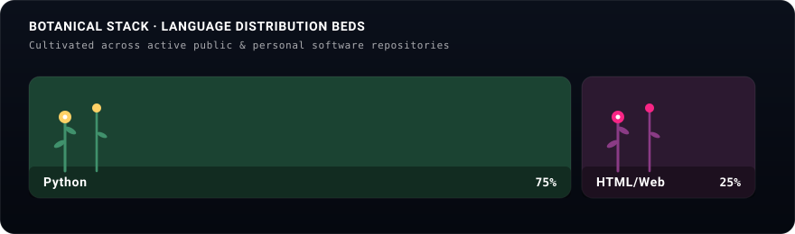
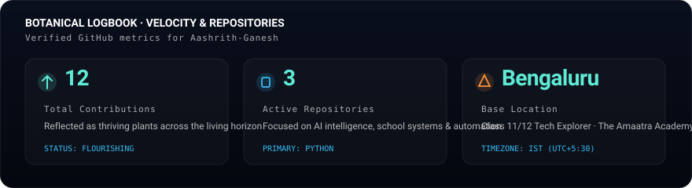

<div align="center">

# 🌿 Aashrith Ganesh

*High-School Technologist · Software Builder · Student at The Amaatra Academy, Bengaluru*

<br/>

<!-- Living Sky & Growing Garden -->
<p align="center">
  
</p>

<p align="center">
  <em>The horizon above reflects live weather and solar time over Bengaluru, India. The foreground garden grows with verified GitHub commits—each plant represents a calendar week.</em>
</p>

</div>

---

### ✦ About Me

I am a student developer based in **Bengaluru, Karnataka (India)**, balancing academic coursework at **The Amaatra Academy** (Class 11/12) with building software tools and intelligent agents. 

My work centers on **autonomous workflows, developer productivity, student opportunity intelligence, and local-first software architecture**. I believe in writing software that operates transparently, respects user privacy, and runs without reliance on proprietary metered cloud APIs.

```text
Location:       Bengaluru, Karnataka, India (N 12.9716°, E 77.5946°)
Timezone:       Indian Standard Time (IST, UTC+5:30)
Education:      The Amaatra Academy (Senior Secondary)
Primary Focus:  Agentic AI, Systems Engineering, Clean Full-Stack Software
Current Goal:   Architecting transparent, student-first opportunity intelligence
```

---

### ✦ Technical Stack & Garden Beds

The garden beds below illustrate the primary technologies cultivated across my active software repositories:

<div align="center">
  
</div>

<br/>

- **Languages:** Python (AsyncIO, FastAPI, Pydantic), TypeScript, JavaScript (ESNext), Modern HTML5 & Semantic CSS3, Shell / Bash, SQL.
- **Frameworks & Runtimes:** FastAPI, Starlette, Uvicorn, Node.js, SQLite 3 (WAL concurrency mode).
- **Architecture & Infrastructure:** Local-first software design, macOS `launchd` automation, GitHub Actions CI/CD, rule-based expert scoring engines, RESTful & WebSocket APIs.
- **Philosophy:** Zero unnecessary cloud dependencies, deterministic execution, accessible high-contrast user interfaces, and strict repository hygiene.

---

### ✦ Featured Projects

Selected public projects engineered for real-world impact and student utility:

#### 1. [Buildathon Radar](https://github.com/Aashrith-Ganesh/buildathon-radar)
> **A student-first hackathon discovery and opportunity intelligence platform**
- **Tech Stack:** `Python 3.13` · `FastAPI` · `SQLite WAL` · `macOS launchd` · `Pytest (444 tests)`
- **Key Capabilities:**
  - Automated multi-source competition discovery across Devpost, Devfolio, Unstop, MLH, and Luma.
  - Transparent 0–100 student relevance rubric operating completely offline without metered LLM APIs.
  - 46-rule academic blackout calendar protecting 69 high-school examination days from schedule clashes.
  - Interactive monthly calendar grid with detailed hover tooltips and unlocked personal loopback tracker.

#### 2. [Campus Passport](https://github.com/Aashrith-Ganesh/Campus-Passport)
> **Student verified credential & campus access navigation platform**
- **Tech Stack:** `HTML5` · `TypeScript` · `Modern CSS Custom Properties`
- **Key Capabilities:**
  - Responsive digital campus identity and event access card for students.
  - Fast, client-side rendering with zero framework bloat.

#### 3. [Invoice Guard](https://github.com/Aashrith-Ganesh/Invoice-Guard)
> **Automated invoice validation and compliance verification engine**
- **Tech Stack:** `Python` · `FastAPI` · `Document Verification`
- **Key Capabilities:**
  - Deterministic invoice anomaly detection, ledger verification, and structured report exports.

---

### ✦ Activity Ledger & Statistics

<div align="center">
  
</div>

<br/>

---

### ✦ How This Living Scene Works

This profile README uses an original, free, and open-source implementation inspired by the concept of dynamic profile landscapes:

1. **Live Weather & Sky Phase:** A GitHub Actions workflow runs periodically (every 4 hours), querying Open-Meteo's free weather API for Bengaluru's current temperature and weather conditions, computing the solar angle (sunrise, daytime, sunset, nighttime), and updating the sky gradient and celestial bodies.
2. **Growing Contribution Garden:** The Python engine retrieves verified GitHub contribution weeks for `@Aashrith-Ganesh` and maps them directly to 52 individual plants along the foreground horizon. Higher contribution activity produces taller stems, extra foliage, and blooming botanical flowers.
3. **Animated Nature:** Subtle pure-CSS animations (`.sway`, `.tw`, `.drift`, `.walk`) bring the landscape to life while respecting `prefers-reduced-motion`.
4. **100% Free & Zero Cloud Tokens:** No paid SaaS subscriptions, no API key exposure in SVG headers, and built-in graceful fallbacks if weather services are unreachable.

---

<div align="center">
  <sub>Built with care in Bengaluru · Powered by Python & SVG · <a href="https://github.com/Aashrith-Ganesh">@Aashrith-Ganesh</a></sub>
</div>
